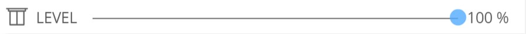
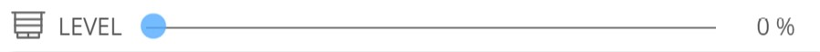
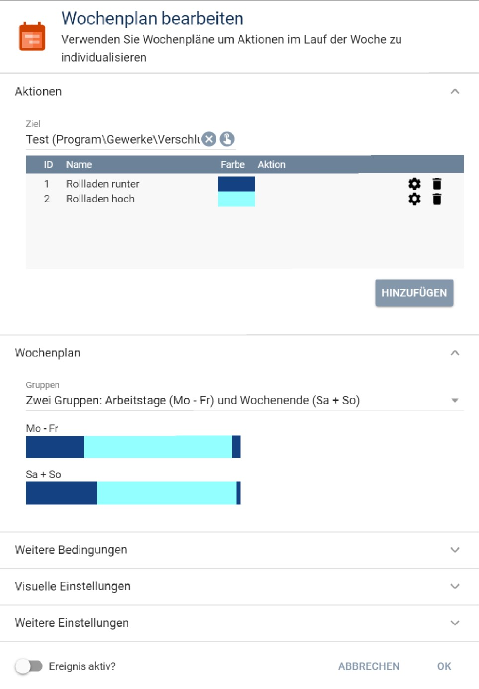
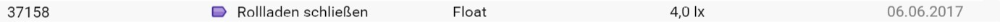

[](https://www.symcon.de/forum/threads/30857-IP-Symcon-5-1-%28Stable%29-Changelog)
[](https://github.com/bumaas/BlindControl/actions/workflows/check.yml)
[](https://www.paypal.me/bumaas)
# Blind Control

Deutsche Fassung: [README.md](README.md)

Module for Symcon version 8.1 or later.

Automates roller shutters, blinds and awnings: fixed times by weekly schedule, opening and closing by daylight, and shading by sun position and temperature. The module takes open windows and doors into account and has an emergency opening.

## Documentation

**Table of contents**

1. [Features](#1-features)
2. [Requirements](#2-requirements)
3. [Installation](#3-installation)
4. [Function reference](#4-function-reference)
5. [Configuration](#5-configuration)
6. [Status variables and presentation](#6-status-variables-and-presentation)
7. [Appendix](#7-appendix)
    1. [Module GUIDs](#module-guids)
    2. [Donations](#donations)

## 1. Features
The Blind Control module controls roller shutters and other shading devices.

Current features:
- Raising and lowering at given times
- Slat position for venetian blinds
- Holidays and vacation days
- Sunrise and sunset
- Brightness
- Sun protection, following the position of the sun
- Random delay at the start and end of the day
- Contacts (window/door, rain, alarm etc.)
- Heat protection
- Emergency sensor
- Detection of manual operation
- Activation and deactivation through a status variable
- Independent of the manufacturer

To make managing several blinds easier, a group master can be defined as well.

## 2. Requirements
 - Symcon 8.1

 - Every actuator is supported that has a status variable and can be controlled through `RequestAction`.
 - The status variable must be of type integer or float.
 - It needs a suitable presentation. Suitable are "Legacy Profile" (with a correct minimum and maximum value), "Shutter", "Slider" and "Enumeration".
 - With a legacy profile, a blind that is closed at the minimum value and open at the maximum value (typical for Homematic, for example) needs a profile whose name ends in ".Reversed".
 - For reversed blinds (minimum value = open, maximum value = closed, or the other way round, typical for Homematic) the "Shutter" presentation is recommended. Its stored values for "open" and "closed" already tell the direction, so no additional ".Reversed" profile is needed.
 - The "Enumeration" presentation carries no direction. It is treated like a legacy profile without ".Reversed" (lowest value = open, highest value = closed) and is therefore only suitable for blinds that are not reversed. Use the "Shutter" presentation for reversed blinds.
 - The status variables should not be emulated. Otherwise the module cannot tell manual movements from its own. If the actuator reports the reached position only with a delay (for example KNX actuators that send their state after the movement has finished), this late feedback of the module's own movement is recognised and not counted as manual operation: if the reported position matches the position last commanded by the module (tolerance: "Minimum of Movement"), the automatic stays active.
 - Controlling the slats of a venetian blind needs a separate status variable for the slat position. The same requirements apply to it.

## 3. Installation

### 3.1 Loading the module

The module is installed through the Module Store (search term: "Blind Control").

### 3.2 Creating a blind instance

In Symcon, choose `Add instance` anywhere in the object tree and search for `Blind Controller`. This creates a blind instance in which the properties for controlling a single blind are configured.

### 3.3 Creating a group master

In Symcon, choose `Add instance` anywhere in the object tree and search for `Blind Control Group Master`.
This creates a group master that combines blinds for editing purposes (not for control!).
It lets you read or set a property of several blinds in one step, which makes managing many blind instances easier.

## 4. Function reference

```php
BLC_ControlBlind(int $InstanceID, bool $considerDeactvationTimes)
```
Checks the blind position according to the properties of the instance and moves the blind to the determined position. If $considerDeactivationTimes == true, DeactivationAutomaticMovement is taken into account. The function is meant for testing only.

```php
BLC_MoveBlind(int $InstanceID, int $percentBlindClose, int $percentSlatsClosed, int $deactivationTimeAuto, string $hint): bool
```
Moves the blind to the requested position. The function is meant for testing only.

$percentBlindClose: 0 - 100
Degree of closure of the curtain (height) (0 = open, 100 = closed)

$percentSlatsClose: 0 - 100
Degree of closure of the slats (position) (0 = open, 100 = closed)

$deactivationTimeAuto: number of seconds that must at least have passed since the last automatic movement. Otherwise the blind is not moved.

$hint: hint written to the status variable LAST_MESSAGE. An empty hint is not written.

```php
BLC_ExplainControlBlind(int $InstanceID): string
```
Performs a **test run** of the control and returns the complete, readable sequence as text. It shows why the blind would move right now, or why it would not.

The test run has **no side effects**: the blind is **not** moved and no state is changed (neither status variables nor internal flags, timers or the locks for manual and automatic movements). The function can therefore be called safely at any time.

The test run also works when the **automatic is switched off** (status variable "Activated" = off); the output then contains a corresponding note. Only with an invalid configuration (instance in an error state) is no test run possible.

```php
BLCGM_GetBlinds(int $InstanceID): array
```
Returns a list of the blinds listed in the group master. Only entries marked as selected are returned.

```php
BLCGM_GetPropertyOfBlinds(int $InstanceID, $Property): array
```
Returns the chosen property of all blinds marked as selected.

```php
BLCGM_SetPropertyOfBlinds(int $InstanceID, string $Property, $Value): bool
```
Sets the property $Property to the value $Value on all blinds marked as selected.

```php
BLCGM_SetBlindsActive(int $InstanceID, bool $active)
```
Sets the status variable 'Activated' to the value $active on all blinds marked as selected.


## 5. Configuration

### 5.1 Checking that the blind is set up correctly in Symcon

The module can only work if the blind to be controlled is set up correctly and completely in Symcon. The blind must position correctly (open, closed and in between), and its direction must be recognised correctly.
The easiest way to check this is to give the position variable (called LEVEL with Homematic, for example) an adaptive icon (for example "Jalousie") and to add it to the visualization.

For an open and a closed blind the visualization should then look like this:




If the icon shows the wrong state, '.Reversed' has to be appended to the profile name. To do this, copy the profile assigned so far and append '.Reversed' to its name (mind upper and lower case). Then assign the new profile to the variable.

Enter this position variable in the module as 'Blind Level ID'.

The same check is recommended for the slat position of venetian blinds.


### 5.2 Setting up the weekly schedule

**Tip:** If you do not have a weekly schedule yet, create it directly from the configuration form: the button "Create weekly schedule" next to the schedule selection creates a default weekly schedule below the instance (open at 07:00, close at 22:00, every weekday) and selects it. Adjust the times in the schedule afterwards; a schedule that is already selected is never overwritten.

The times of movement come from a weekly schedule event with the following settings:



The module only reads the action times and the action type from the schedule.

**Important:**
- The weekly schedule must contain exactly two actions with the IDs 1 and 2. The actions themselves stay empty (without function), because Symcon is not supposed to run the schedule itself. Choose the action that runs PHP code and leave the code field empty.
- The action with ID 1 defines **lowering**, ID 2 **raising** the blind.
- There may be at most one period for action 2 (raising).
- The lowering time is the first switching point of action 1 **after** raising. Whether the day starts at 00:00 with action 1 (as in the picture) or only with raising makes no difference.
- Whether the schedule itself is marked as "active" in Symcon is not considered.

This schedule defines the basic times (up in the morning, down in the evening).

A weekly schedule is mandatory. If no specific schedule is needed (for example because the blinds are only lowered for sun protection), a basic schedule meeting the conditions above must still exist.
This can be a schedule with the actions 1 and 2 in which only one period of ID 2 is defined over 24 hours (00:00 to 24:00).

**Note:** If the blinds should only move for shading (no classic day/night change), the 24-hour schedule described above is enough. Deactivating the schedule in Symcon has no effect, because only its action times and action types are evaluated.

**Recipe for changing times (for example a shift plan):** If you need times that change every day instead of fixed schedule times (for example following a duty roster), use the overriding time variables `WakeUpTimeID` (wake-up time) and `BedTimeID` (bedtime). Create two string variables in the format `HH:MM`, select them in the instance under "Overruling Up and Down Times (optional)" and fill them by script or event. For example, read tomorrow's shift from a calendar in the evening (such as the module [iCal-Calendar](https://github.com/bumaas/iCal-Calendar)) and write the matching times into the two variables. Valid times in these variables take precedence over the weekly schedule; an invalid or empty time is ignored, and the schedule applies again.

On holidays and vacation days the schedule of another weekday can apply (`HolidayIndicatorID`, `DayUsedWhenHoliday`). Debug and explanation then name the holiday or vacation day and the weekday used.

### 5.3 Day detection (optional)
In addition to the weekly schedule, a day detection can be set up. It is used when the brightness should be considered besides the fixed times.

**Example:**
According to the weekly schedule the blind is raised at 8:00 in the morning and lowered at 23:00 in the evening. It should, however, only go up when it is actually light (day) already, and go down as soon as it gets dark.

With day detection, the blind goes up (and stays up) only if **both** conditions are met:
1. The opening time of the weekly schedule has been reached.
2. It is "day".

As soon as one of the conditions is no longer met, the blind is lowered.

There are two ways to detect the day:
1.  **Reference to an existing variable:** the variable `IsDay` of the Location module is a good choice, for example.
2.  **Brightness comparison:** this needs a variable with the current brightness (from a brightness sensor, for example) and a variable with the threshold.

To use the average of the last minutes for the brightness comparison, enter the period in minutes. The average is calculated from the archived data, so archiving must be enabled in Symcon for the brightness variable.



#### 5.3.1 Overriding start and end of the day (optional)
Optionally, a fixed start and/or end time of the day can override the detection. Reference a variable that contains the time in the format 'HH:MM'.
These times override the times found by the day detection.


### 5.4 Shading (optional)

There are two kinds of shading: "by sun position" and "by brightness". Both can be used at the same time. The shading height is then the minimum of both kinds.

#### 5.4.1 Shading by sun position (optional)
Enter the variables that provide the position of the sun (azimuth = direction of the sun, altitude = height of the sun). The variables of the same name in the Location module are a good choice.

Also enter the range of the sun direction (azimuth from/to) in which shading should take place.
Ranges across 0° are possible, for example 280° to 70° for north-facing windows. Such a range can be entered in two equivalent ways: `240` to `120` or `240` to `480` (values up to 720° are allowed).
For a brightness comparison, enter the variable with the current brightness (from a brightness sensor, for example) and a variable with the threshold. To use the average of the last minutes as the brightness value, enter the number of minutes over which the average is taken. The average comes from the archived data, so archiving must be enabled for the variable.

Additionally, a temperature variable (outdoor temperature) can be entered. It works in **two ways**:

1. **Start of shading (brightness threshold):** above 24 °C the threshold is lowered (10 % per degree above 24 °C), so shading starts earlier; below 10 °C it is raised (10 % per degree below 10 °C), so the sun is 'locked out' later.
2. **Curtain height (heat protection):** above 27 °C the blind is lowered by another 15 %; above 30 °C it is lowered to a degree of closure (curtain height) of at least 90 %. If the shading calculation already results in more than 90 % closure, that stays. The temperature only limits opening, it never prevents further closing.

Note: heat protection (point 2) applies as long as shading by sun position is active (brightness above threshold, azimuth and altitude within the configured range), even when the sun geometrically no longer hits the window.

To find the right curtain height for different sun altitudes, there are two alternative methods: a "simple" and a "more precise" one. The simple method is only suitable for vertical (facade) windows, the more precise one for both vertical and inclined (roof) windows.
- With the simple method, enter the desired curtain heights for two sun altitudes that are as far apart as possible. The curtain height for the current altitude is calculated from these two positions. The values are best determined by observation at midday and in the evening, or in midsummer and winter.
With a correct calibration the shadow of the blind always reaches the same distance into the room, which gives even shading.

- With the precise method you directly set how deep the sun may shine into the room. The shading position is calculated from the window position, the window height, the minimum and maximum shade relevant position and the current altitude and azimuth of the sun. This method is used as soon as the depth is set.

#### 5.4.2 Shading by brightness (optional)
Enter the variables used to determine the brightness. When the brightness exceeds the threshold, the blind moves to the given position. Two pairs of brightness threshold and blind position are available.

The rule can be switched by an activation variable.

If shading by brightness and shading by sun position are both active, shading by brightness works **in addition** to shading by sun position.

A practical example:
Normally shading follows the position of the sun. When the TV is switched on, the room should be darkened more or less depending on the brightness.

### 5.5 Contacts (optional)
To react to open windows and doors, or to rain and storm, up to four contacts can be defined. In the classic on/off mode a contact counts as open when its value is >0; for contacts that have the value 0 when open, use a 'Reversed' profile. If value groups are configured instead (see below), the raw value comparison applies instead of the >0 check.

Two contacts each are available for these functions:
*   **Open (window/door):** enter the position the blind should *at least* move to.
*   **Close (rain/wind):** enter the position the blind should *at most* move to.

When a contact is detected as open, the blind moves to the given position immediately. When the contact closes again, the height valid at that moment is determined anew and approached immediately.

Special case: if open contacts for closing and for opening are detected at the same time (for example the door is open and it is raining), the **contacts for opening take precedence**.

The **contacts for opening** also support **value groups**: instead of a plain on/off evaluation, each contact can hold up to three groups of raw values (comma-separated, type boolean/integer/float/string), each with its own position (height and slats). For numeric variables (integer/float), **comparisons and ranges** are possible besides exact values: `>x`, `>=x`, `<x`, `<=x` and `a-b` (limits included), for example `>0.2` or `0.2-0.8`. Always use the **decimal point**; the comma separates the values. The comma-separated values of a group are combined with **or**, so `>3,<5` matches every value. A range with excluded limits can be written with narrower limits (for example `3.001-4.999` for "between 3 and 5 without 3 and 5"; for integer values `4` is enough). If all value fields of a contact stay empty, it behaves as before as an on/off contact with the classic height and slat position (`ContactOpenLevel{i}` / `ContactOpenSlatsLevel{i}`). If the current value matches no group, the contact has no effect. The groups are checked in the order 1 to 3; the first matching group determines the position. Each opening contact can have its own delay (debounce); every further telegram restarts the waiting time, so only the last reported value is evaluated. The debounce is meant for bouncing contacts and handles. With variables that keep delivering new values (for example a float wind sensor), the waiting time restarts with every change, and the evaluation can be postponed indefinitely. Leave the delay at 0 there and smooth the measurement with a helper variable if necessary (see below).

A window handle with three positions can be mapped with these value groups: select the position variable of the handle as an opening contact and enter the raw values per position as a value group, for example with SODA `left,right` for open and `up` for tilted as two positions; `down` matches no group and therefore has no effect (closed). Since a handle can send several intermediate positions while it is turned, a debounce (for example 1 second) through the delay of the contact is recommended.

An example of the comparison syntax: to open the blind below an awning as soon as the awning is extended, select the LEVEL variable of the awning (range 0.0 to 1.0) as an opening contact and enter, for example, `>0.05` as the raw value for position 1. Every noticeable extension then moves the blind to the configured minimum height; with the awning retracted (value 0) the normal automatic applies again.

The comparisons have **no hysteresis**: the condition is checked exactly at every evaluation. If a measurement swings around the limit (for example wind around `>20`), the contact state changes just as often. The "Deactivation Time after automatic Movement" does not prevent this either, because it deliberately does not apply to contacts. For such measurements a small helper variable is recommended that an event or script sets with its own hysteresis or hold time (for example "wind" on from 20, off only after 15 minutes below 15); the module then only gets the stable state as a contact.

The **contacts for closing** support the same value groups and the same debounce as the contacts for opening. If several closing contacts are open at the same time, the most closed position is approached, so the most restrictive requirement is met.

### 5.6 Blind Controller

**Note**: always enter the **raw values of the variable** (no converted values).
Which raw value means "open" and which means "closed" is shown in the form directly below the selected height or slats variable (for example "All blind level values in this form are raw values of this variable: 1 = open, 0 = closed").
*Examples*:
*   If the variable has a range of **0 to 255**, enter **255** for "closed" (not 100).
*   If the variable has a range of **0.0 to 1.0** and is open at 1.0 (Homematic, for example), enter **0.0** for "closed".

**Value ranges**: the number fields have the limits named in the form (for example sun altitude -90° to 90°, window slope 0° to 180°, times not negative). They also apply when the instance is configured by script or through the group master. If a value is out of range, the instance goes into the error state "A given value is out of range (see message log)", and the message names the affected field.

| Property | Type | Default | Function |
|:---|:---:|:---|:---|
| `BlindLevelID` | integer | 0 | (Blind Level ID) Status variable of the blind to be controlled. It must be of type integer or float and have a correct profile. |
| `SlatsLevelID` | integer | 0 | (Slats Level ID) Status variable of the slats of a venetian blind. It must be of type integer or float and have a correct profile. |
| <br>**Weekly schedule** | | | |
| `WeeklyTimeTableEventID` | integer | 0 | (Weekly Timetable Event ID) Reference to a weekly schedule event that defines the basic daily times for raising and lowering the blind. |
| `WakeUpTimeID` | integer | 0 | (Wake-Up Time ID) String variable with an overriding time for raising. The time must have the format 'HH:MM'. An invalid time is ignored. |
| `WakeUpTimeOffset` | integer | 0 | (Wake-Up Time Offset) Offset to the wake-up time in minutes |
| `BedTimeID` | integer | 0 | (Bedtime ID) String variable with an overriding time for lowering. The time must have the format 'HH:MM'. An invalid time is ignored. |
| `BedTimeOffset` | integer | 0 | (Bedtime Offset) Offset to the bedtime in minutes |
| `HolidayIndicatorID` | integer | 0 | (Holiday Indicator ID) Indicator variable that shows whether it is a holiday or vacation day |
| `DayUsedWhenHoliday` | integer | 0 | (Used Weekday when Holiday) Defines which weekday of the weekly schedule is used on a holiday or vacation day. Debug and explanation then name the holiday or vacation day and the weekday used |
| `ActivatedIndividualDayLevels` | boolean | false | (The blind should not be opened completely at day.) Activates the individual day positions |
| `DayBlindLevel` | float | 0 | (Blind Level) Height the blind moves to during the day when it is to be opened |
| `DaySlatsLevel` | float | 0 | (Slats Level) Position the slats move to during the day when they are to be opened |
| `ActivatedIndividualNightLevels` | boolean | false | (The blind should not be closed completely at night.) Activates the individual night positions |
| `NightBlindLevel` | float | 0 | (Blind Level) Height the blind moves to at night when it is to be closed |
| `NightSlatsLevel` | float | 0 | (Slats Level) Position the slats move to at night when they are to be closed |
| <br>**Day detection** | | | |
| `IsDayIndicatorID` | integer | 0 | (Is Day Indicator ID) Indicator variable that shows whether it is day or night. The ISDAY status variable of the Location Control can be used, for example. |
| `BrightnessID` | integer | 0 | (Brightness ID) Indicator variable with the brightness for the day/night decision. |
| `BrightnessAvgMinutes` | integer | 0 | (Average of the last minutes) Number of minutes over which the average brightness is taken |
| `BrightnessThresholdID` | integer | 0 | (Brightness Threshold ID) Indicator variable with the threshold for the day/night decision |
| `DayStartID` | integer | 0 | (Start of the day ID) String variable with an overriding start of the day. The time must have the format 'HH:MM' and be earlier than '12:00'. An invalid time is ignored. |
| `DayEndID` | integer | 0 | (End of the day ID) String variable with an overriding end of the day. The time must have the format 'HH:MM' and be later than '12:00'. An invalid time is ignored. |
| `DelayTimeDayNightChange` | integer | 0 | (Delay Time of Day Night Change) Defines whether and how long a movement at the day/night change is delayed |
| `DelayTimeDayNightChangeIsRandomly` | boolean | false | (Delay Time of Day Night Change is randomly) Defines whether the delay is random. A random value between 0 and the given time is used |
| <br>**Shading by sun position** | | | |
| `ActivatorIDShadowingBySunPosition` | integer | 0 | (Activator ID) Indicator variable that activates shading by sun position. The control is active when the value of the variable is >0 |
| `AzimuthID` | integer | 0 | (Azimuth ID) Indicator variable with the current direction of the sun. |
| `AltitudeID` | integer | 0 | (Altitude ID) Indicator variable with the current altitude of the sun. |
| `AzimuthFrom` | float | 0 | (From Azimuth) Sun direction from which shading is active |
| `AzimuthTo` | float | 0 | (To Azimuth) Sun direction up to which shading is active |
| `AltitudeFrom` | float | 0 | (From Altitude) Sun altitude from which shading is active |
| `AltitudeTo` | float | 0 | (To Altitude) Sun altitude up to which shading is active |
| `BrightnessIDShadowingBySunPosition` | integer | 0 | (Brightness ID) Indicator variable with the brightness for shading by sun position |
| `BrightnessAvgMinutesShadowingBySunPosition` | integer | 0 | (Average of the last minutes) Number of minutes over which the average brightness is taken |
| `BrightnessThresholdIDShadowingBySunPosition` | integer | 0 | (Brightness Threshold ID) Indicator variable with the threshold for shading by sun position |
| `TemperatureIDShadowingBySunPosition` | integer | 0 | (Temperature ID) Indicator variable of a temperature sensor (outdoor temperature). The value works **in two ways**: on the brightness threshold (start of shading) and on the curtain height (heat protection: above 27 °C another 15 % down, above 30 °C to 90 % closure). On the brightness threshold: above 24 °C the threshold is lowered for earlier shading (10 % per degree above 24 °C). Below 10 °C it is raised to 'lock out' the sun later (10 % per degree below 10 °C). |
| ***Degree of shading, simple method***<br>`LowSunPositionAltitude`<br>`HighSunPositionAltitude`<br>`LowSunPositionBlindLevel`<br>`HighSunPositionBlindLevel`<br>`LowSunPositionSlatsLevel`<br>`HighSunPositionSlatsLevel` | float | 0 | The curtain height and slat position for the current sun altitude are calculated from these value pairs, which should be as far apart as possible |
| <br>***Degree of shading, precise method*** | | | |
| `DepthSunLight` | integer | 0 | (Maximum depth of sunlight) How deep the sun may shine into the room, measured on the horizontal plane below the window. |
| `WindowOrientation` | integer | 0 | (Orientation of the window) Direction the window faces (south window = 180°) |
| `WindowsSlope` | integer | 90 | (Slope of the window) Inclination of the window, **measured against the horizontal**: vertical facade window = 90°, flat roof window = 0°. For inclined roof windows the value is the roof pitch (example: roof with 45° pitch → 45°). |
| `WindowHeight` | integer | 0 | (Height of the window) Height of the glass inside the frame |
| `ParapetHeight` | integer | 0 | (Height of the Parapet) Distance from the lower edge of the glass to the shadow level |
| `MinimumShadeRelevantBlindLevel` | float | 0 | (Minimum shade relevant blind level) Blind level at which the lower edge of the blind is level with the upper edge of the glass. |
| `HalfShadeRelevantBlindLevel` | float | 0 | (Half shade relevant blind level) Blind level at which the blind covers exactly half of the window. It is needed to calculate the non-linear part of the relation between running time and curtain height. Without it a linear relation is assumed. |
| `MaximumShadeRelevantBlindLevel` | float | 0 | (Maximum shade relevant blind level) Blind level at which the lower edge of the blind is level with the lower edge of the glass. |
| `MinimumShadeRelevantSlatsLevel` | float | 0 | (Minimum shade relevant slats level) Slat level that lets through the most light |
| `MaximumShadeRelevantSlatsLevel` | float | 0 | (Maximum shade relevant slats level) Slat level that lets through the least light |
| <br>**Shading by brightness** | | | |
| `ActivatorIDShadowingBrightness` | integer | 0 | (Activator ID) Indicator variable that activates shading by brightness. The control is active when the value of the variable is >0 |
| `BrightnessIDShadowingBrightness` | integer | 0 | (Brightness ID) Indicator variable with the brightness for shading by brightness |
| `BrightnessAvgMinutesShadowingBrightness` | integer | 0 | (Average of the last minutes) Number of minutes over which the average brightness is taken for shading by brightness |
| `ThresholdIDHighBrightness` | integer | 0 | (Threshold high brightness ID) Indicator variable with the high brightness threshold |
| `BlindLevelHighBrightnessShadowingBrightness` | float | 0 | (Blind Level at high brightness) Blind level approached when the high brightness is reached |
| `SlatsLevelHighBrightnessShadowingBrightness` | float | 0 | (Slats Level at high brightness) Slat level approached when the high brightness is reached |
| `ThresholdIDLessBrightness` | integer | 0 | (Threshold less brightness ID) Indicator variable with the low brightness threshold |
| `BlindLevelLessBrightnessShadowingBrightness` | float | 0 | (Blind Level at less brightness) Blind level approached when the lower brightness is reached |
| `SlatsLevelLessBrightnessShadowingBrightness` | float | 0 | (Slats Level at less brightness) Slat level approached when the lower brightness is reached |
| <br>**Contacts** | | | |
| `ContactOpen1ID`, `ContactOpen2ID` | integer | 0 | (Contact 1 ID, Contact 2 ID) Indicator variables (boolean, integer, float or string). Without value groups they work as on/off contacts; with value groups one of the three positions is approached depending on the raw value. |
| `ContactOpenLevel1`, `ContactOpenLevel2` | float | 0 | (Minimum height when the contact is open) Minimum height for **position 1**. Without value groups this is also the on/off opening height. |
| `ContactOpenSlatsLevel1`, `ContactOpenSlatsLevel2` | float | 0 | (Minimum slats position when the contact is open) Minimum slat position for position 1 or the on/off mode. |
| `ContactOpenValues1_1`, `ContactOpenValues1_2`, `ContactOpenValues1_3`, `ContactOpenValues2_1`, `ContactOpenValues2_2`, `ContactOpenValues2_3` | string | (empty) | Optional comma-separated raw values per contact i∈{1,2} and position 1–3. If the current value matches a group, the corresponding position is approached. A value that matches no group has no effect, and the normal automatic applies again. So do not assign the normal state (for example window closed) to a group. |
| `ContactOpenLevel1_2`, `ContactOpenLevel2_2`, `ContactOpenLevel1_3`, `ContactOpenLevel2_3` | float | 0 | Minimum height of the additional positions 2 and 3 per contact (position 1 = `ContactOpenLevel{i}`). |
| `ContactOpenSlatsLevel1_2`, `ContactOpenSlatsLevel2_2`, `ContactOpenSlatsLevel1_3`, `ContactOpenSlatsLevel2_3` | float | 0 | (Minimum slats position) Minimum slat position of the additional positions 2 and 3 per contact. |
| `ContactOpenDelay1`, `ContactOpenDelay2` | integer | 0 | (Delay before evaluation (debounce)) Delay in seconds per opening contact before the last reported value is evaluated. Every further telegram restarts the delay. With `0` the evaluation is immediate. **Caution:** with measurement variables that keep sending (wind, for example), every change postpones the evaluation again; leave the delay at 0 there. |
| `ContactClose1ID`, `ContactClose2ID` | integer | 0 | (Contact 1 ID, Contact 2 ID) Indicator variables (boolean, integer, float or string). Without value groups they work as on/off contacts; with value groups one of the three positions is approached depending on the raw value. |
| `ContactCloseLevel1`, `ContactCloseLevel2` | float | 0 | (Maximum height when the contact is open) Maximum height for **position 1**. Without value groups this is also the on/off closing height. |
| `ContactCloseSlatsLevel1`, `ContactCloseSlatsLevel2` | float | 0 | (Maximum slats position when the contact is open) Maximum slat position for position 1 or the on/off mode. |
| `ContactCloseValues1_1`, `ContactCloseValues2_1`, `ContactCloseValues1_2`, `ContactCloseValues2_2`, `ContactCloseValues1_3`, `ContactCloseValues2_3` | string | (empty) | Comma-separated raw values per position (up to three) of a closing contact. If all stay empty, the classic on/off behaviour applies. If the value matches no group, the contact has no effect, and the normal automatic applies again. So do not assign the normal state to a group. |
| `ContactCloseLevel1_2`, `ContactCloseLevel2_2`, `ContactCloseLevel1_3`, `ContactCloseLevel2_3` | float | 0 | Maximum height of the additional positions 2 and 3 per contact (position 1 = `ContactCloseLevel{i}`). |
| `ContactCloseSlatsLevel1_2`, `ContactCloseSlatsLevel2_2`, `ContactCloseSlatsLevel1_3`, `ContactCloseSlatsLevel2_3` | float | 0 | (Maximum slats position) Maximum slat position of the additional positions 2 and 3 per contact. |
| `ContactCloseDelay1`, `ContactCloseDelay2` | integer | 0 | (Delay before evaluation (debounce)) Delay in seconds per closing contact before the last reported value is evaluated. Every further telegram restarts the delay. With `0` the evaluation is immediate. **Caution:** with measurement variables that keep sending (wind, for example), every change postpones the evaluation again; leave the delay at 0 there. |
| `ContactsToCloseHaveHigherPriority` | boolean | false | (Contacts to close the blind have a higher priority than the ones to open) Defines whether the contacts for closing a blind have a higher priority than the ones for opening. |
| <br>**Emergency contact** | | | |
| `EmergencyContactID` | integer | 0 | (Emergency contact ID) Emergency indicator: if the contact is not 0, the blind is opened immediately. At the same time the automatic is taken out of operation. |
| <br>**Expert parameters** | | | |
| `UpdateInterval` | integer | 1 | (Update Interval) Defines the interval in which the control runs |
| `DeactivationAutomaticMovement` | integer | 20 | (Deactivation Time after automatic Movement) Defines how long during the day no further automatic movement takes place after an automatic movement. This prevents the blind from moving at too short intervals, for example with fluctuating brightness. <br>The time does not apply to contacts and to the day/night change. |
| `DeactivationManualMovement` | integer | 120 | (Deactivation Time after manual Movement) Defines how long during the day no automatic movement takes place after a movement that this control did not trigger (for example after manual operation).<br>Without a value (=0) the blind position stays until the next day/night change.<br>Exceptions: the time does not apply to contacts; they move immediately. It also does not apply when a blind was closed completely by hand; the blind then stays closed. |
| `MinMovement` | float | 5 | (Minimum of Movement, in percent) Defines the deviation below which a target position counts as reached. |
| `MinMovementAtEndPosition` | float | 5 | (Minimum of Movement to reach End Position, in percent) Defines the deviation below which an end position counts as reached. |
| `ShowNotUsedElements` | boolean | false | (Show not used elements) Defines whether the configuration form also shows input fields that are not in use. Example: without a slats ID, the fields for slats are hidden by default. |
| `WriteLastDecision` | boolean | false | Defines whether the optional status variable LAST_DECISION is created. It records why the blind moved or did not move in the last control run (see status variables). |
| `WriteDecisionTrace` | boolean | false | Defines whether the optional status variable DECISION_TRACE is created. It holds the complete sequence of the last control run as HTML (see status variables). |
| `WriteLogInformationToIPSLogger` | boolean | false | Defines whether log information is also passed to the IPSLogger of the IPSLibrary in addition to the standard log file (requires an installed IPSLibrary). |
| `WriteDebugInformationToIPSLogger` | boolean | false | Defines whether debug information is also passed to the IPSLogger of the IPSLibrary in addition to the debugger (requires an installed IPSLibrary). |
| `WriteDebugInformationToLogfile` | boolean | false | Defines whether debug information is also written to the standard log file. Important: this requires the Symcon special switch 'LogfileVerbose' to be enabled |

## 6. Status variables and presentation

The following status variables are created:

#### ACTIVATED
Switches the automatic control on and off. When the automatic is switched on (again), previously detected manual operations are discarded.

#### LAST_MESSAGE
Holds a note about the last movement. To keep track of the movements of a blind, enable archiving for this variable. The visualization then shows the movements as a log.
Configuration errors are reported here as well. Once such an error is fixed, the entry "Configuration is valid" follows, so the error message does not remain as the last state. The messages appear in the language of the Symcon installation (like the explanation).

#### LAST_DECISION
This status variable is **optional**. It is only created if the option **"Create status variable "Last Decision""** is enabled in the configuration form (otherwise an existing variable is removed again).

It records the decision of the last control run and answers the question **why the blind moved, or why it did not**. To avoid repeated identical entries (for example a permanent "target position already reached"), the variable is only updated when the decision differs from the previous run.

Examples:
- `Movement: closed. (Night)`
- `Movement: height 30 % closed, slats 50 % closed. (Shadowing by sun position)`
- `No movement: manual operation detected (14:05), locked until 16:05.`
- `No movement: target position already reached (target: opened, Day).`

To show the history of decisions as a log in the visualization, enable archiving for this variable.

#### DECISION_TRACE
This status variable is **optional**. It is only created if the option **"Create status variable "Last Decision Trace""** is enabled in the configuration form (otherwise an existing variable is removed again).

It contains the **complete sequence of the last control run**: the same steps as the "Explain" test run (see below), but for the run actually executed. The content is HTML and is shown through the **"Web Content"** presentation, so it appears formatted in the visualization instead of as raw text.

Unlike `LAST_DECISION` (one-line final decision, updated only on a *change*), `DECISION_TRACE` is rewritten in **every** control run and also contains a timestamp. So the complete decision path of the last run can be followed at any time.

### Explain decision (test run)

Below the actions, the configuration form offers the button **"Explain decision (test run, no movement)"**. It performs a test run without side effects (the blind is **not** moved and no state is changed) and shows the complete decision step by step: from the current position through day/night detection, movement locks, base target position, shading and contacts to the result. So you can see at a glance **why** the blind would move right now or not.

The test run also works when the **automatic is switched off** (status variable "Activated" = off). The output then starts with the note that the determined movement would only be carried out with the automatic switched on. Only with an invalid configuration (instance in an error state) is no test run possible.

The output appears in the language of the Symcon installation, as do `LAST_DECISION` and `DECISION_TRACE`.

Example output while shading:
```
Explanation of the control run (test run - the blind is not moved):

Current position: 30 % closed
Time of day: Day (Weekly schedule: Day, Day detection: Day, Brightness: 12000 lx)
Movement lock: none
Base target position: opened (Day)
Shadowing: active -> height 60 % closed (Shadowing by sun position, brightness 45000 lx ≥ threshold 30000 lx)
Result: Movement: height 60 % closed (Shadowing by sun position).
```

The line "Movement lock" refers to the lock after a **detected manual operation**: if the curtain height changes without the module having triggered the movement (push button, visualization, another script), the automatic pauses. During the day it pauses for the "Deactivation Time after manual Movement" (0 = until the next day/night change); if the curtain was closed completely by hand or operated at night, it pauses until the next day/night change. At the day/night change and when the automatic is switched on again (status variable ACTIVATED), the remembered operation is discarded. "Movement lock: none" means that no such lock is present right now.

The time in brackets is the time of the **detected manual operation**. If it is not today, it is shown as "yesterday" or with a date (for example `yesterday 21:57` or `31.07. 21:57`). This can happen when the automatic was switched off for a longer time and the remembered operation was therefore not discarded yet.

A **late position feedback of the actuator** is not counted as manual operation: if the status variable reports the position of the last automatic movement only after the movement has finished (typical for KNX actuators with a long running time), the module recognises the change as feedback of its own movement, provided the reported position matches the last commanded one (tolerance: "Minimum of Movement"). The trace then shows, for example, `Movement lock: none (position change at 09:35 matches the last commanded position (actuator feedback, no manual operation))`.

The shading line shows the brightness value **actually used** for the shading decision together with the threshold. This value can differ from the brightness named in the line "Time of day": a different brightness sensor may be configured for shading than for day/night detection, and if averaging over several minutes is set, shading uses an effective value from the current and the averaged measurement. If the averaged value is actually used, the trace marks it, for example `brightness 45000 lx (average over 10 min)`. The same applies to the line "Time of day" when an average is used there.

If a **temperature sensor** is configured, its value is used for shading by sun position and becomes visible in the trace:
- The brightness threshold is adjusted to the temperature (10 % per degree above 24 °C or below 10 °C). When this adjustment applies, the threshold is shown together with the configured base value, for example `threshold 21000 lx (temperature-corrected from 70000 lx, 31 °C)`, so you recognise your own threshold directly. The same note appears in the reason when there is no shading because the brightness is too low (`brightness … below threshold … (temperature-corrected from …)`).
- Above 27 °C or 30 °C the curtain is lowered further; this appears in the shading line together with its effect in plain text: `Thermal protection: 28 °C > 27 °C -> 15 % further closed` or `Heat protection: 31 °C > 30 °C -> at least 90 % closed`.

```
Shadowing: active -> height 90 % closed (Shadowing by sun position, brightness 45000 lx ≥ threshold 21000 lx (temperature-corrected from 70000 lx, 31 °C), Heat protection: 31 °C > 30 °C -> at least 90 % closed)
```

Example output when there is **no** shading; the reason is named exactly (activation, brightness, azimuth or sun altitude):
```
Explanation of the control run (test run - the blind is not moved):

Current position: opened
Time of day: Day (Weekly schedule: Day, Day detection: Day, Brightness: 8000 lx)
Movement lock: none
Base target position: opened (Day, 8000 lx)
Shadowing: none (by sun position: brightness 8000 lx below threshold 30000 lx, azimuth 210.0° outside 240.0°-290.0°)
Result: No movement: target position already reached (target: opened, Day, 8000 lx).
```

The contact line is **always** shown and names the contact state even when no contact affects the position (for example `Contacts: no contact open` or `Contacts: not configured`). If an open contact (window, rain, emergency) affects the position, the resulting target position is named.

The same sequence is also written to the debug of the instance in **every** control run (entry `executeControlBlindRun` with the text `Ablauf: …`; debug lines are always German) and is thus available for troubleshooting as well.

## 7. Appendix

###  Module GUIDs

|           Module           |  Type  |                  GUID                  |
|:--------------------------:|:------:|:--------------------------------------:|
|      Blind Controller      | Device | {538F6461-5410-4F4C-91D3-B39122152D56} |
| Blind Control Group Master | Device | {1ACD8A0D-5385-6D05-9537-F24C9014FD02} |

### Donations

Using the module is free of charge. Nobody should feel obliged, but if you like the module, I am happy about a donation.

<a href="https://www.paypal.me/bumaas" target="_blank"></a>
